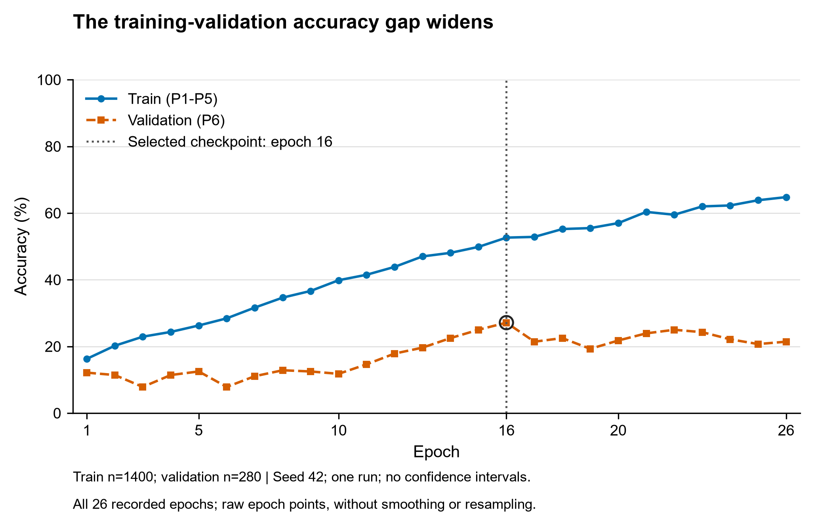
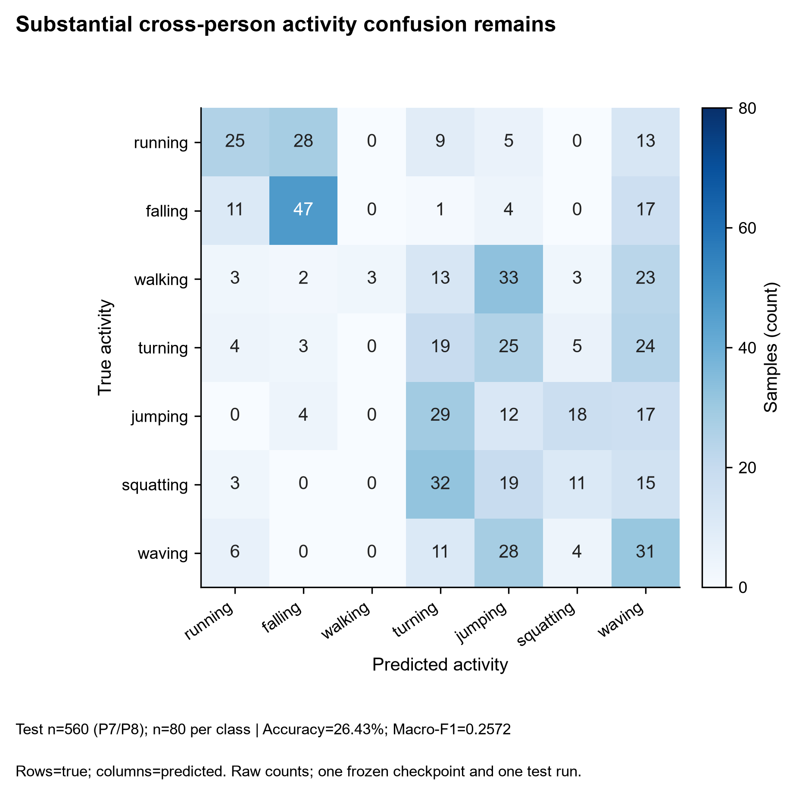

# Wi-Fi CSI Cross-Person Activity Recognition

**基于ESP-Fi HAR幅度序列的轻量1D CNN跨人员动作识别基线。**

A fixed participant-disjoint baseline with training-only normalization, validation-selected checkpoints, and archived seven-class test results.

[实验报告](reports/wifi_csi_baseline_report_final.pdf) · [快速开始](#快速开始) · [复现指南](docs/REPRODUCIBILITY.md) · [学习笔记](docs/README.md) · [数据来源](https://github.com/AutoSmartGroup/ESP-Fi-HAR)

## 项目概览

核心问题是：**训练时未见过某位参与者，模型还能否识别其动作？**

本项目在ESP-Fi HAR上建立固定跨人员七分类基线，从数据配对、人员划分、训练集标准化到checkpoint选择和一次正式测试，保留完整结果来源。使用简单可检查的1D CNN，而非追求复杂架构。

| 项目 | 设置 |
|---|---|
| 样本 | 2,240对MAT/CSV，每对对应一个样本 |
| 数据覆盖 | 8名参与者、4个环境、7类动作 |
| 输入 | 幅度序列(950, 52)，模型输入(B, 52, 950) |
| 模型 | LightweightCNN，35,655个参数 |
| 评价 | 固定跨人员划分；Accuracy与Macro-F1 |

## 实验协议

| 集合 | 参与者 | 样本数 | 用途 |
|---|---|---:|---|
| Train | P1–P5 | 1,400 | 拟合标准化、更新模型权重 |
| Validation | P6 | 280 | checkpoint选择与早停 |
| Test | P7–P8 | 560 | 模型冻结后的正式评价 |

标准化只使用训练集，按通道累计均值和总体标准差（ddof=0）。三组人员不重叠，各组均含四个环境，因此这里是**跨人员**实验，不是留一环境评价。

```text
CSI amplitude (B, 52, 950)
  → Conv1d(52, 64, kernel=3) → ReLU → MaxPool1d(2)
  → Conv1d(64, 128, kernel=3) → ReLU
  → AdaptiveAvgPool1d(1) → Flatten → Linear(128, 7)
```

输出为logits，配合CrossEntropyLoss；不在损失计算前额外加入Softmax。实现见[src/model.py](src/model.py)。

## 已归档结果

| 指标或设置 | 结果 |
|---|---:|
| Test Accuracy | **26.4286%**（148/560） |
| Test Macro-F1 | **0.257181** |
| 最佳Validation Accuracy | 27.1429% |
| 最佳checkpoint | Epoch 16 |
| 实际训练轮数 | 26（早停） |
| Seed | 42 |

来源：[测试指标](results/formal_seed42/test/test_metrics.json)、[训练记录](results/formal_seed42/metrics.csv)、[结果分析](results/formal_seed42/analysis.md)。checkpoint按Validation Accuracy选择，相同时比较Validation Loss，不按测试表现重选。



*训练与验证表现存在明显差距。当前基线的未见人员识别能力有限，不能据此声称已具备可靠部署能力。*



正式结果保持原样，不因分数偏低重新选择模型或测试划分。也不与采用不同数据划分的外部项目直接排名。

## 快速开始

```bash
git clone https://github.com/wzhikun-helper/wifi-csi-har.git
cd wifi-csi-har
```

先按[复现指南](docs/REPRODUCIBILITY.md)准备环境；依赖声明见[environment.yml](environment.yml)，尚未完成跨机器安装验证。在已准备的环境中，可**不读取真实数据数组、不训练、不推理**地运行：

```bash
python -B -m unittest discover -s tests -v
python -B scripts/run_experiment.py --config configs/formal_seed42.yaml --output-dir results/readme_check_001 --device cpu --dry-run
python -B scripts/evaluate.py --output-dir results/readme_eval_001 --checkpoint models/formal_seed42/epoch_016.pt --device cpu --check-only
python -B reports/wifi_csi_baseline_report_final/verify_release.py
```

目标目录必须不存在；预检不创建结果目录。去掉预检开关会进入真实训练或评价，请先阅读[运行协议](reports/wifi_csi_baseline_report_final/PIPELINE_REPRODUCTION.md)，不要在正式归档目录重跑。

## 数据与公开范围

数据来自[AutoSmartGroup/ESP-Fi-HAR](https://github.com/AutoSmartGroup/ESP-Fi-HAR)，获取与使用遵循原作者说明。本仓库不分发原始MAT/CSV；授权数据应放在data/raw/ESP-Fi_dataset/并保留原目录名。

七类动作是running、falling、walking、turning、jumping、squatting、waving，对应标签0–6。配对文件不是两个独立样本；不能从950个位置推断未经确认的采样率或持续时间。

公开内容包括[样本元数据](results/dataset_manifest.csv)、[固定人员划分](results/dataset_split.csv)、训练记录、正式测试结果、[最佳权重](models/formal_seed42/epoch_016.pt)及[normalizer](models/csi_normalizer.npz)。其他历史checkpoint仅本地保留，不属于公开发布范围。

## 报告与文档

| 内容 | 入口 |
|---|---|
| 完整实验报告 | [6页PDF](reports/wifi_csi_baseline_report_final.pdf) · [LaTeX源码](reports/wifi_csi_baseline_report_final/main.tex) · [编译说明](reports/wifi_csi_baseline_report_final/COMPILE.md) |
| CSI基础 | [Wi-Fi CSI学习笔记](notes/wifi_csi_notes.md) |
| 时序深度学习 | [Conv1d与一维时序学习笔记](notes/deep_learning_1d_timeseries_notes.md) |
| 环境、预处理与运行入口 | [复现指南](docs/REPRODUCIBILITY.md) · [完整协议](reports/wifi_csi_baseline_report_final/PIPELINE_REPRODUCTION.md) |
| 实验来源与核验 | [发布说明](reports/wifi_csi_baseline_report_final/RELEASE.md) · [文档导航](docs/README.md) |

## 目录结构

```text
configs/                Smoke与正式实验配置
src/                    Dataset、模型与安全运行模块
scripts/                数据检查、训练、评价与绘图入口
tests/                  临时合成数据测试
results/                样本清单、人员划分与冻结结果
models/                 训练集normalizer和正式最佳权重
figures/formal_seed42/  训练曲线、混淆矩阵及分类结果
reports/                正式报告、LaTeX源码及来源记录
notes/                  CSI与Conv1d学习笔记
docs/                   复现指南与文档导航
```

## 局限与复现边界

- 仅一个seed、一次固定人员划分和两名测试人员，不能推断所有新人员上的效果。
- 未验证跨环境、跨硬件或实际部署泛化；当前测试表现有限。
- 新克隆可核验当前88项发布索引；历史47项中10个中间checkpoint仅本地保留。
- 跨机器完整训练尚未验证；环境声明、功能测试和数值复现是不同层次的证据。

本仓库尚未指定开源许可证；代码与原始数据的许可需分别确认，不自动继承参考项目的许可。
